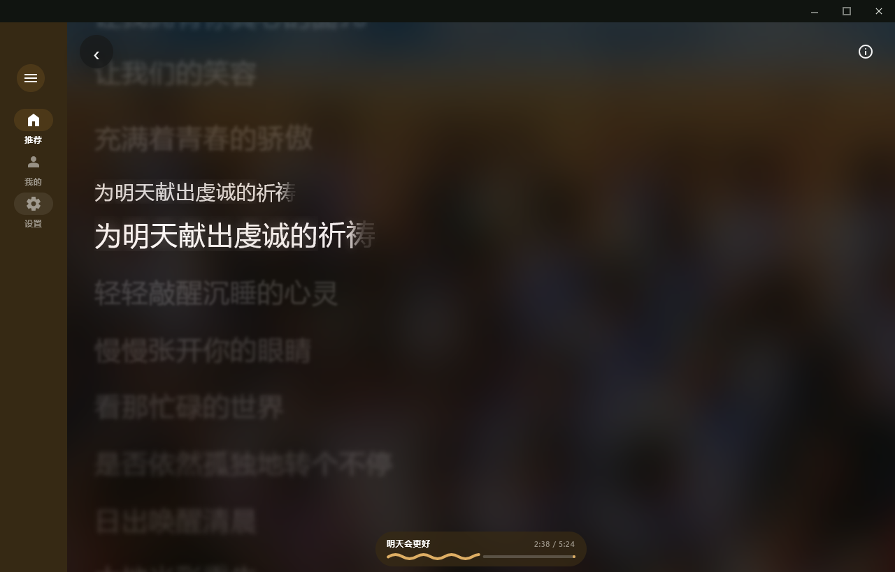

# AMLL Jetpack Compose

**Apple Music-style lyrics for Compose Multiplatform.** Word-by-word karaoke highlighting,
spring-driven scrolling, blurred album-art backgrounds — the full
[Apple Music-like Lyrics](https://github.com/amll-dev/applemusic-like-lyrics) experience,
rendered natively by Compose on Android, iOS, desktop and the web. No WebView, no embedded
JavaScript, no HTML host page.

<p align="center">
  
</p>

## Why

AMLL is the best-looking open-source lyric renderer there is, and it is written for the
browser. Shipping it inside a native app means shipping a WebView: a second rendering engine,
a JavaScript bridge for every playback event, platform-specific hosting code, and a class of
bugs that only reproduce on one vendor's browser build.

This library is a line-by-line port of AMLL's engine to Kotlin and Compose. The parsers, the
lyric optimizer, the spring physics, the layout algorithm, the word masks and emphasis
animation all use the upstream formulas and constants. What changes is only the surface they
draw on: Compose `Canvas`, `graphicsLayer` and `TextMeasurer` instead of DOM, CSS and Web
Animations. You get one code path on every platform, no bridge, and a renderer you can debug
with the tools you already use.

## Features

- **Formats** — LRC, NetEase YRC (per-syllable) and Apple TTML, including translations,
  romanization, background vocals, duet alignment and ruby text.
- **Word-level animation** — mask gradients that sweep across each syllable, emphasis
  float / scale / glow on held notes, and the interlude dots between verses.
- **Motion** — AMLL's spring model for scrolling and line scale, distance-based blur, inertial
  drag, click-to-seek, and the same timing tables upstream uses.
- **Artwork background** — cropped, saturated, blurred and dimmed the way the AMLL page does
  it, with an optional slot for a dynamic (video) cover.
- **Accessible** — every line is a real focus target with keyboard navigation, focus rings and
  semantics; the OS "reduce motion" setting is honoured on all platforms.
- **Cheap to run** — a spring step updates layer properties, not the composition; groups
  outside the overscan band are not drawn; the background blur is rendered once per artwork.

## Platforms

| Target | Text segmentation | Reduced motion | Notes |
|---|---|---|---|
| Android (24+) | ICU `BreakIterator` | Settings observer | Blur needs API 31; older devices get a downsampled cover |
| iOS | CoreFoundation tokenizer | `UIAccessibility` | `iosArm64`, `iosSimulatorArm64` |
| Desktop (JVM) | `BreakIterator` | Windows system setting | macOS / Linux read `amll.reduceMotion` |
| Web (Wasm) | `Intl.Segmenter` | `prefers-reduced-motion` | Install the DOM event bridge (below) |

## Getting started

The library is a Gradle build of its own. The simplest way to use it is as a git submodule
included into your build:

```sh
git submodule add https://github.com/RedSTARO/AMLL_Jetpack_Compose AMLL_Jetpack_Compose
```

```kotlin
// settings.gradle.kts
includeBuild("AMLL_Jetpack_Compose")
```

```kotlin
// your module's build.gradle.kts
commonMain.dependencies {
    implementation("com.leejlredstar.amll:amll-compose")
}
```

Kotlin, Compose Multiplatform, AGP and the target set are pinned in
[`gradle/libs.versions.toml`](gradle/libs.versions.toml). An included build only substitutes
when both sides compile the same Kotlin targets with the same compiler, so keep your catalog on
the same versions.

## Usage

Parse whatever you have into the AMLL lyric model, build a document, and hand it to the
viewport together with the playback position:

```kotlin
import com.leejlredstar.amll.compose.*
import com.leejlredstar.amll.compose.lyric.*

// 1. Lyrics → model. Any of these, depending on what your source provides.
val lines: List<LyricParser.WordLine> = TtmlLyricParser.parse(ttmlText)
// val lines = LyricParser.parseYrc(yrcText)
// val lines = LyricParser.parseLrcLines(lrcText)

// 2. Model → document (runs AMLL's optimizer and attaches translation / romanization rows).
val document = buildAmllLyricDocument(
    lyricMap = linkedMapOf(),
    wordLines = lines,
    translatedLrc = translatedLrcText,
    romanLrc = romanLrcText,
    showTranslated = true,
    showRoman = false,
)

// 3. Document → screen.
@Composable
fun LyricsScreen(positionMs: State<Long>, isPlaying: Boolean, onSeek: (Long) -> Unit) {
    val reducedMotion = rememberReducedMotionEnabled()
    BoxWithConstraints(Modifier.fillMaxSize()) {
        val parameters = calculateAmllLyricVisualParameters(
            viewportWidthDp = maxWidth.value,
            viewportHeightDp = maxHeight.value,
            reducedMotion = reducedMotion,
        )
        AmllBackground(
            artworkUri = "https://…/cover.jpg",
            fallbackArtworkUri = null,
            dynamicCoverUrl = null,
            playDynamicCover = false,
            androidPresentation = false,
            reducedMotion = reducedMotion,
            onArtworkLoaded = {},
            modifier = Modifier.fillMaxSize(),
        )
        AmllLyricViewport(
            document = document,
            mediaId = "track-id",
            sampledPositionMs = positionMs.value,
            positionState = positionMs,
            isPlaying = isPlaying,
            parameters = parameters,
            androidPresentation = false,
            onSeek = { _, ms -> onSeek(ms) },
            onInteraction = {},
            modifier = Modifier.fillMaxSize(),
        )
    }
}
```

`positionState` should tick at your player's clock rate; the viewport interpolates between
samples with `withFrameNanos`, so 100 ms samples are enough for smooth word masks.

### Web

Compose for Web receives wheel events after the browser has already normalised them. Install
the DOM bridge above your root so AMLL gets the real `WheelEvent.deltaMode` and
page-visibility transitions:

```kotlin
CompositionLocalProvider(LocalAmllPlatformEventBridge provides WebAmllPlatformEventBridge) {
    App()
}
```

### Dynamic covers

`AmllBackground` never decodes video. Pass a `dynamicCoverLayer` composable and it will be
placed under AMLL's blur, brightness and scrim with the URL, the play request and the
reduced-motion preference — use Media3, `AVPlayerLayer`, FFmpeg or an `HTMLVideoElement`,
whichever your platform has.

## Scope

This repository is the lyric renderer and the lyric model. Playback, now-playing metadata,
artwork loading policy and player chrome belong to the host app; `AmllLyricViewport` takes a
document and a position and calls back with a seek. The
[RedefineNCM KMP](https://github.com/RedSTARO/RedefineNCM_KMP) player is the reference host.

## Fidelity

Every TypeScript, CSS and host-page symbol that was ported is listed against its Kotlin
counterpart in [`docs/AMLL_NATIVE_TRANSLATION.md`](docs/AMLL_NATIVE_TRANSLATION.md), together
with the places where a browser API has no Compose equivalent and what was chosen instead.
The port targets AMLL core `0.5.2`, lyric `1.0.2` and ttml `1.0.1`.

## Building

```sh
./gradlew :amll-compose:jvmTest                          # engine, parser and layout tests
./gradlew :amll-compose:compileAndroidMain
./gradlew :amll-compose:compileKotlinWasmJs
./gradlew :amll-compose:compileKotlinIosSimulatorArm64   # source only; linking needs macOS
```

## Contributing

Issues and pull requests are welcome. Changes to the engine should stay traceable to an
upstream AMLL symbol — add the mapping to the translation document — and come with a test in
`amll-compose/src/commonTest`.

## License

[AGPL-3.0-only](LICENSE), inherited from Apple Music-like Lyrics. Copyright the AMLL
contributors and the RedefineNCM KMP contributors; see
[`THIRD_PARTY_NOTICES.md`](THIRD_PARTY_NOTICES.md).
